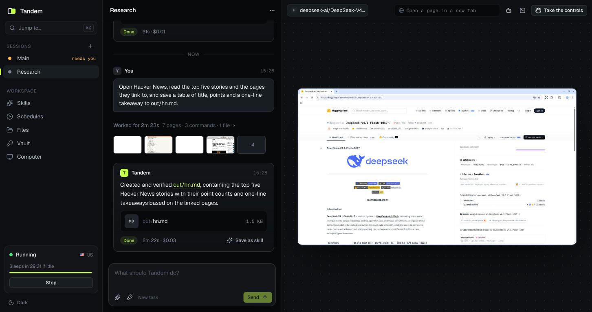

# Pine Computer starter

A complete product built on [Pine Computer](https://pinecomputer.io): an agent with its
own computer that browses and works in a shell, signs in and stays signed in, learns your
workflows, runs on a schedule, and hands you the controls whenever you want them.

It ships as **Tandem**, a name to replace: rename it in [`src/brand.ts`](src/brand.ts),
change `--accent` in [`src/app/globals.css`](src/app/globals.css), and it's yours. Every
feature is a few files you can read and copy, built on the TypeScript server SDK,
[`@pinesandbox/computer`](https://www.npmjs.com/package/@pinesandbox/computer), and the Web
SDK, [`@pinesandbox/computer-web`](https://www.npmjs.com/package/@pinesandbox/computer-web).



## What it does

| Feature | What a person does | How it's built | Where |
| --- | --- | --- | --- |
| **Sessions side by side** | Run up to three jobs at once, each with its own browser, shell and agent, all signed in to the same accounts | `createSession`, sessions reopened by name after every Start, the limit from `capabilities()` | [`src/server/pine.ts`](src/server/pine.ts), [`src/ui/app/Shell.tsx`](src/ui/app/Shell.tsx) |
| **Tasks, steering, answers** | Give a task, steer it while it works, answer its questions, cancel it | `agent.run` with an idempotency key; `steer`, `answer`, `cancel` naming their turn | [`api/sessions/[session]/runs`](src/app/api/sessions/[session]/runs/route.ts), [`…/turns`](src/app/api/sessions/[session]/turns/[turnId]/route.ts) |
| **The work, live** | Watch every step, grouped by the page it ended on, with the screens it left | `agent.events()` and `controlEvents()` relayed as one resumable server-sent stream | [`…/events`](src/app/api/sessions/[session]/events/route.ts), [`src/ui/session/fold.ts`](src/ui/session/fold.ts) |
| **The screen, and the controls** | See the desktop, open pages in tabs, take the controls and hand back | `delegateDesktop` into `<PineDesktop>`, `takeControl` / `releaseControl`, `listTabs` / `createTab` | [`src/ui/session/Stage.tsx`](src/ui/session/Stage.tsx) |
| **Skills** | Save a good run as a skill, or show it once and teach it; read the draft, activate it, refine it | `startLearn`, `startTeach` with the handoff, `startRefine`, `authorEvents`, `skills.drafts/activate` | [`src/ui/session/Author.tsx`](src/ui/session/Author.tsx), [`src/ui/skills`](src/ui/skills) |
| **Vault** | Keep sign-ins and keys the agent uses as `$NAME` without ever seeing them | `secrets` on every run, answer and steer, sealed at rest | [`src/server/vault.ts`](src/server/vault.ts) |
| **Files in and out** | Attach files to a task, browse and download the work directory, download the files a turn returned | `writeFile` into `attachments/`, `listFiles`, `openFile` (each file a turn's `result.artifacts` names, streamed) | [`src/ui/files`](src/ui/files), [`src/server/turns.ts`](src/server/turns.ts) |
| **Schedules** | Run a task every hour, or each weekday at nine, with no page open | A worker in the server process starts the Computer when it must; each slot's run key runs it once | [`src/server/schedules.ts`](src/server/schedules.ts), [`src/server/worker.ts`](src/server/worker.ts) |
| **History that outlives the Computer** | Find every answer and file after Stop | The worker follows each turn with `agent.wait` and copies its files in | [`src/server/turns.ts`](src/server/turns.ts) |
| **Shell** | Run commands beside the agent and watch the output stream | `session.exec` with `onEvent` | [`…/exec`](src/app/api/sessions/[session]/exec/route.ts) |
| **Your own agent** | Let your own model drive the session (Claude, with `ANTHROPIC_API_KEY`) | `drive.computerUse` and `screenshot`: the Computer is the hands and eyes | [`src/server/drive.ts`](src/server/drive.ts) |
| **Passkeys** | Approve a site's new passkey from a prompt; the Computer keeps it | `pendingPasskeyCeremonies`, `approvePasskeyCeremony`, `listPasskeys` | [`src/ui/app/Toasts.tsx`](src/ui/app/Toasts.tsx), [`src/ui/computer`](src/ui/computer) |
| **The Computer** | Choose its country and idle timeout; Pause, Resume, Stop, Start, Recover or Delete it; run a health check | `availableLocations`, `setIdleTimeout`, `sandboxDetails`, lifecycle calls, `createDiagnostic` | [`src/ui/computer`](src/ui/computer), [`api/computer`](src/app/api/computer/route.ts) |

Everything changes live: the server pushes what happened (a task finished, a scheduled
task needs an answer, a site wants a passkey) and every view updates. Press <kbd>⌘K</kbd>
to jump anywhere.

## Run it

You need Node.js 22 or later and a Pine Computer project with an API key. Pine Computer
is in private beta: [request access](https://pinecomputer.io).

```sh
git clone https://github.com/PineComputer/pine-computer-starter.git
cd pine-computer-starter
npm install
cp .env.example .env.local   # then add your project's API key and a STARTER_SECRET
npm run dev
```

Open <http://localhost:3000> and choose **Create your Computer**.

| Setting | |
| --- | --- |
| `PINE_SANDBOX_ENDPOINT`, `PINE_SANDBOX_API_KEY` | Your project's endpoint and key, from the console. |
| `STARTER_SECRET` | Encrypts what the app keeps about its Computer: `openssl rand -base64 32`. |
| `STARTER_DATA_DIR` | Where it keeps its records and copied files. Default `.data/`. |
| `ANTHROPIC_API_KEY`, `ANTHROPIC_MODEL` | Optional: lets your own model drive a session. Default model `claude-opus-5-5`. |

## How it fits together

```
Browser                          This app's server                                Pine
───────                          ─────────────────                                ────
<PineDesktop>   ── token ──────▶ POST /api/sessions/:s/desktop ── delegateDesktop ──▶ screen
EventSource     ◀── events ───── GET  /api/sessions/:s/events ─── agent.events()  ◀── activity
                                                                  controlEvents()
EventSource     ◀── changes ──── GET  /api/live   ◀── the worker ── agent.wait()   ◀── turns
                                                      schedules ── agent.run()     ──▶ runs
Composer        ── task ───────▶ POST /api/sessions/:s/runs ───── agent.run(key)   ──▶ turn
                                 .data/  credentials, binding, session tokens and vault (sealed),
                                         sessions, turns, schedules, and the files turns returned
```

- **The server holds every secret.** The project key, the Computer's credentials and
  binding, session tokens and vault values never reach a browser, which only ever holds a
  two-minute desktop token.
- **Every request rebuilds the Computer** from its saved records, so a restart carries on
  where the last process stopped.
- **The worker** ([`src/instrumentation.ts`](src/instrumentation.ts)) runs in the server
  process: it records finished turns, fires schedules and watches for passkey requests.
- **One person, one machine.** The app answers only on `127.0.0.1`, and only to its own
  pages ([`src/proxy.ts`](src/proxy.ts)).

## Before you ship something like it

- **Add your sign-in** in [`src/proxy.ts`](src/proxy.ts) and
  [`src/server/user.ts`](src/server/user.ts). Records are already kept per user; give each
  user (or workspace) their own Computer.
- **Move the records to your database**, and the encryption key to your secret manager.
- **Run one worker.** It lives in the server process here; with several processes, run it
  once (a job queue, or a lock), and keep the event streams on a long-lived server.
  Serverless hosts cut long requests short and don't keep `.data/`.
- **Handle the errors you can act on**: `RunUnconfirmedError` (send the run again with the
  same key), `SandboxRetainedError` (it's still running or paused), and
  `isRetryable(error)` for the rest. See the SDK's README.

## Develop

```sh
npm run check   # typecheck and tests
npm run build
```

## License

[Apache-2.0](LICENSE), like the SDKs it's built on.
